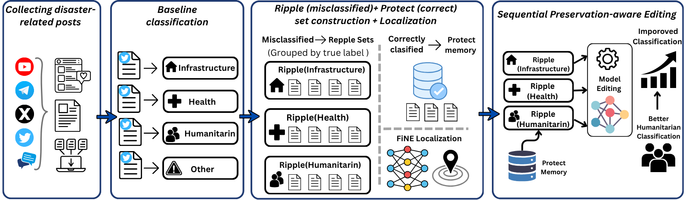
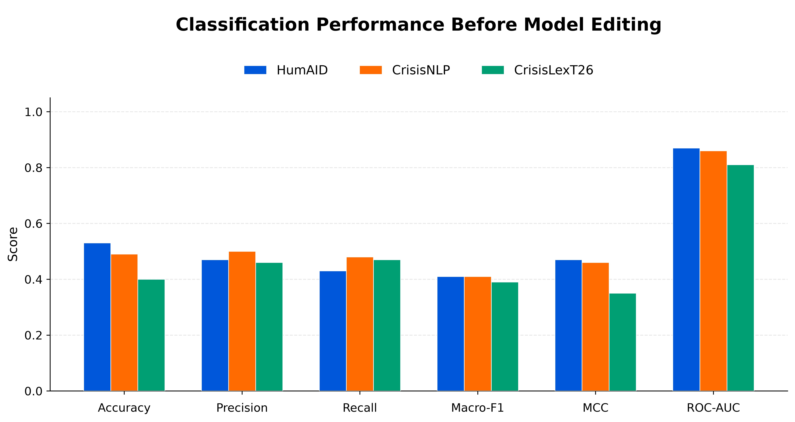
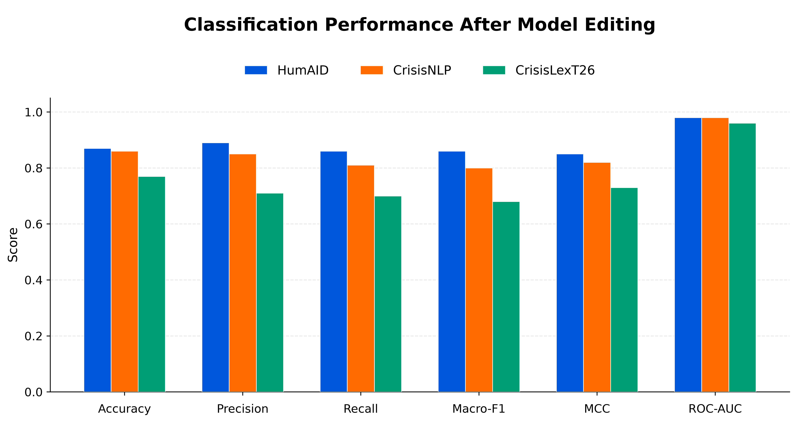
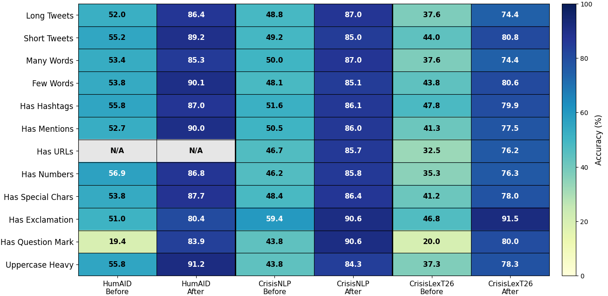

# SPARE

**Sequential Preservation-Aware Ripple Editing for disaster-related social media classification.**

SPARE corrects the classification errors of a large language model on disaster-related social media posts while preserving the predictions that were already correct. Misclassified posts are grouped into class-specific **Ripple groups**, and correctly classified posts form one global **Protect memory**. The neurons behind each group's errors are located with **FiNE**. A MEND/HiEdit-style low-level editor then edits the groups one after another, constrained by a KL preservation loss and **A-GEM** gradient projection.

The experiments use **Qwen2.5-3B-Instruct** on **HumAID**, **CrisisNLP** and **CrisisLexT26**.



## Repository structure

```text
spare/                  Python package (the code used for the paper, as reusable modules)
├── config.py           hyperparameters (Table 4 of the paper)
├── data.py             dataset loaders, train/test splits, evaluation sampling
├── prompting.py        one-shot domain prompt, output parsing, label scoring
├── baseline.py         stage 1: one-shot classification with the unedited model (W0)
├── ripple_protect.py   stage 2: Ripple groups and the global Protect memory
├── localization.py     stage 3: FiNE neuron localization
├── editor.py           low-level editor H_theta
├── editing.py          stage 4: editor training (KL + A-GEM) and sequential editing W0 -> WT
├── evaluation.py       stage 5: classification and knowledge-editing metrics
├── linguistic.py       accuracy per linguistic subgroup
├── plots.py            bar charts, confusion matrices, linguistic heatmap
└── cli.py              command-line interface (python -m spare)
scripts/lumi_job.sh     SLURM job for LUMI (CSC)
tests/                  fast offline tests
HUMAID/, CrisisNLP/, CrisisLexT26/   original experiment notebooks
figs/                   figures used in the paper
RESULTS.md              results summarized from the figures
```

## Installation

Python 3.10 or newer and a GPU are needed for the full pipeline (the paper used one GPU with bfloat16).

```bash
pip install -r requirements.txt
pip install -e .
```

On **LUMI**, install PyTorch from CSC's ROCm module instead of pip. The header of [`requirements.txt`](requirements.txt) gives the steps, and [`scripts/lumi_job.sh`](scripts/lumi_job.sh) does them inside a SLURM job:

```bash
sbatch --account=project_<id> scripts/lumi_job.sh HumAID
```

HumAID and CrisisLexT26 are downloaded from the Hugging Face Hub (`QCRI/HUMAID-all`, `QCRI/CrisisBench-all-lang`). CrisisNLP is downloaded from crisisnlp.qcri.org. To run offline, put `CrisisNLP_labeled_data_crowdflower_v2.zip` in `data/crisisnlp_raw/`.

## Usage

Run all five stages for one dataset:

```bash
python -m spare run --dataset HumAID --out-dir runs
```

The stages are `baseline`, `groups`, `localize`, `edit` and `evaluate`. Each one writes CSV files that the next one reads, so you can run them separately:

```bash
python -m spare run --dataset CrisisNLP --stages baseline,groups,localize
python -m spare run --dataset CrisisNLP --stages edit,evaluate
```

The edited weights exist only in memory, so `evaluate` runs in the same call as `edit`. If you want to evaluate in a later job instead, add `--save-edited-model` to `edit` (about 6 GB on disk). Editor training saves a checkpoint after every pass and resumes from it automatically.

Ablations reuse stages 1–3 and write into their own subfolder (`no_kl`, `no_agem`, `no_kl_no_agem`):

```bash
python -m spare run --dataset HumAID --stages edit,evaluate --no-kl
python -m spare run --dataset HumAID --stages edit,evaluate --no-agem
python -m spare run --dataset HumAID --stages edit,evaluate --no-kl --no-agem
```

Draw the figures once the runs are finished:

```bash
python -m spare plot --runs HumAID=runs/HumAID_500_run CrisisNLP=runs/CrisisNLP_500_run CrisisLexT26=runs/CrisisLexT26_500_run --out figs_out
```

Run `python -m spare run --help` for all options (number of samples, training passes, seed, skipping the slower probes).

## Outputs

For each dataset, `runs/<Dataset>_500_run/` holds:

| File | Content |
|---|---|
| `*_one_shot_domain_predictions.csv` | W0 predictions with the exact prompts |
| `*_ripple_sets.csv`, `*_protect_sets.csv` | Ripple groups and Protect memory |
| `*_FiNE_ripple_localization.csv` | localized neurons per Ripple member |
| `full/*_seq_edit_generated_diagnostic.csv` | per-group diagnostics during sequential editing |
| `full/*_FINAL_W0_WT_generated.csv` | W0 and WT prediction for every evaluation sample |
| `full/*_classification_before_after.csv` | Accuracy, Precision, Recall, Macro-F1, MCC, ROC-AUC |
| `full/*_editing_metrics.csv` | S, ES, RG, NS, FR, PC, GE, DR, PR |
| `full/*_linguistic_subgroups.csv` | accuracy per linguistic subgroup |

## Method

1. **Baseline.** Qwen2.5-3B-Instruct classifies 500 test posts with a one-shot domain prompt (one training example per class, greedy decoding).
2. **Ripple and Protect.** Misclassified posts are grouped by their true label, one Ripple group per class. All correctly classified posts form one global Protect memory.
3. **FiNE localization.** For each misclassified post, the top-5 FFN neurons contributing to its wrong label are found across all layers except the last three. A group's mask keeps the neurons shared by at least half of its members.
4. **Sequential editing.** The editor maps the rank-1 gradient of the edit loss to a masked update of `down_proj`. It is trained over the whole group sequence with:
   - the edit loss, including earlier groups;
   - a KL term on the Protect memory;
   - an update-norm penalty;
   - A-GEM projection against a Protect reference gradient.

   The trained editor is then applied group by group, without resetting the model in between.
5. **Evaluation.** Classification metrics are reported before and after editing, together with the knowledge-editing metrics defined in the paper.

## Tests

```bash
pip install pytest
pytest tests
```

## Results

All results use Qwen2.5-3B-Instruct with the one-shot domain prompt. "Before" is the original model and "After" is the model after SPARE editing. The complete tables are in [`RESULTS.md`](RESULTS.md).

### Classification performance

| Metric | HumAID Before | HumAID After | CrisisNLP Before | CrisisNLP After | CrisisLexT26 Before | CrisisLexT26 After |
|---|---|---|---|---|---|---|
| Accuracy | 0.53 | 0.87 | 0.49 | 0.86 | 0.40 | 0.78 |
| Precision | 0.47 | 0.89 | 0.50 | 0.85 | 0.46 | 0.71 |
| Recall | 0.43 | 0.86 | 0.48 | 0.81 | 0.47 | 0.70 |
| Macro-F1 | 0.41 | 0.86 | 0.41 | 0.80 | 0.39 | 0.68 |
| MCC | 0.47 | 0.85 | 0.46 | 0.82 | 0.35 | 0.73 |
| ROC-AUC | 0.87 | 0.98 | 0.86 | 0.98 | 0.81 | 0.96 |

Editing improves every metric on all three datasets. Accuracy rises by 34–38 percentage points and Macro-F1 by 29–45 percentage points.

| Before editing | After editing |
|---|---|
|  |  |

### Per-class recall on HumAID


After editing, recall rises for nine of the ten classes, and *injured or dead people* stays at 0.87. The largest gains are:

| Class | Before | After |
|---|---|---|
| Other relevant information | 0.03 | 0.93 |
| Missing or found people | 0.25 | 1.00 |
| Not humanitarian | 0.39 | 1.00 |
| Requests or urgent needs | 0.40 | 0.90 |

The largest remaining confusion is *caution and advice* predicted as *other relevant information* (0.35).

### Linguistic subgroups



Accuracy improves for all 12 subgroups on all three datasets. Tweets with question marks gain the most: +64.5 points on HumAID, +46.8 on CrisisNLP and +60.0 on CrisisLexT26. HumAID has no tweets with URLs in the evaluation sample, so that cell is N/A.

## Citation

Citation information will be added when the associated paper is published.
