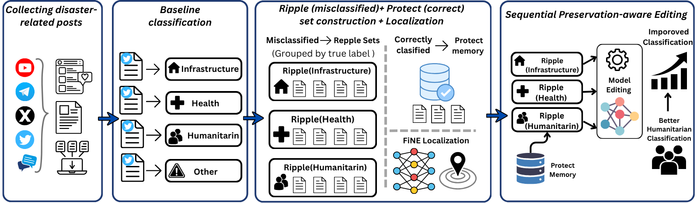

# Results

All results use **Qwen2.5-3B-Instruct** with the domain-specific one-shot prompt as the starting point ("Before") and the model after SPARE editing ("After").

## Overview

## Classification performance before and after editing

Figures: [`figs/before_edit.png`](figs/before_edit.png), [`figs/after_edit.png`](figs/after_edit.png)

| Metric | HumAID Before | HumAID After | CrisisNLP Before | CrisisNLP After | CrisisLexT26 Before | CrisisLexT26 After |
|---|---|---|---|---|---|---|
| Accuracy | 0.53 | 0.87 | 0.49 | 0.86 | 0.40 | 0.78 |
| Precision | 0.47 | 0.89 | 0.50 | 0.85 | 0.46 | 0.71 |
| Recall | 0.43 | 0.86 | 0.48 | 0.81 | 0.47 | 0.70 |
| Macro-F1 | 0.41 | 0.86 | 0.41 | 0.80 | 0.39 | 0.68 |
| MCC | 0.47 | 0.85 | 0.46 | 0.82 | 0.35 | 0.73 |
| ROC-AUC | 0.87 | 0.98 | 0.86 | 0.98 | 0.81 | 0.96 |

Editing improves every metric on all three datasets. Accuracy increases by 34, 37 and 38 percentage points, and Macro-F1 by 45, 39 and 29 percentage points, on HumAID, CrisisNLP and CrisisLexT26 respectively.

## Per-class recall on HumAID

Figures: [`figs/HUM.png`](figs/HUM.png), [`figs/hum-before-step.png`](figs/hum-before-step.png), [`figs/hum-after-step.png`](figs/hum-after-step.png)

Diagonal values of the row-normalized confusion matrices:

| Class | Abbr. | Before | After |
|---|---|---|---|
| Caution and advice | CA | 0.38 | 0.50 |
| Displaced people and evacuations | DPE | 0.58 | 0.79 |
| Infrastructure and utility damage | IUD | 0.69 | 0.84 |
| Injured or dead people | IDP | 0.87 | 0.87 |
| Missing or found people | MFP | 0.25 | 1.00 |
| Not humanitarian | NH | 0.39 | 1.00 |
| Other relevant information | ORI | 0.03 | 0.93 |
| Requests or urgent needs | RUN | 0.40 | 0.90 |
| Rescue, volunteering or donation effort | RVDE | 0.72 | 0.95 |
| Sympathy and support | SS | 0.52 | 0.84 |

Main confusions before editing:

- MFP predicted as IDP (0.75)
- ORI predicted as IDP (0.30) or IUD (0.27)
- RUN predicted as RVDE (0.40)
- SS predicted as IDP (0.21)
- CA predicted as IUD (0.21)

After editing, recall rises for nine of the ten classes, and IDP stays at 0.87. The largest remaining confusion is CA predicted as ORI (0.35), followed by DPE predicted as ORI (0.12), IUD predicted as ORI (0.10) and RUN predicted as CA (0.10).

## Accuracy by linguistic subgroup

Figure: [`figs/Ling.png`](figs/Ling.png). Accuracy in %. Subgroups overlap, since a tweet can belong to several. HumAID has no tweets with URLs in the evaluation subset (N/A).

| Subgroup | HumAID Before | HumAID After | CrisisNLP Before | CrisisNLP After | CrisisLexT26 Before | CrisisLexT26 After |
|---|---|---|---|---|---|---|
| Long tweets | 52.0 | 86.4 | 48.8 | 87.0 | 37.6 | 74.4 |
| Short tweets | 55.2 | 89.2 | 49.2 | 85.0 | 44.0 | 80.8 |
| Many words | 53.4 | 85.3 | 50.0 | 87.0 | 37.6 | 74.4 |
| Few words | 53.8 | 90.1 | 48.1 | 85.1 | 43.8 | 80.6 |
| Has hashtags | 55.8 | 87.0 | 51.6 | 86.1 | 47.8 | 79.9 |
| Has mentions | 52.7 | 90.0 | 50.5 | 86.0 | 41.3 | 77.5 |
| Has URLs | N/A | N/A | 46.7 | 85.7 | 32.5 | 76.2 |
| Has numbers | 56.9 | 86.8 | 46.2 | 85.8 | 35.3 | 76.3 |
| Has special characters | 53.8 | 87.7 | 48.4 | 86.4 | 41.2 | 78.0 |
| Has exclamation mark | 51.0 | 80.4 | 59.4 | 90.6 | 46.8 | 91.5 |
| Has question mark | 19.4 | 83.9 | 43.8 | 90.6 | 20.0 | 80.0 |
| Uppercase heavy | 55.8 | 91.2 | 43.8 | 84.3 | 37.3 | 78.3 |

Accuracy improves for every subgroup on all three datasets. The largest gains are for tweets with question marks: +64.5 points on HumAID, +46.8 on CrisisNLP and +60.0 on CrisisLexT26.
